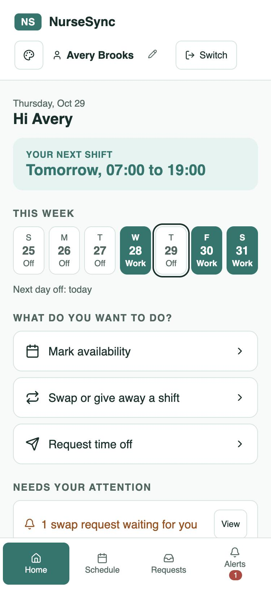
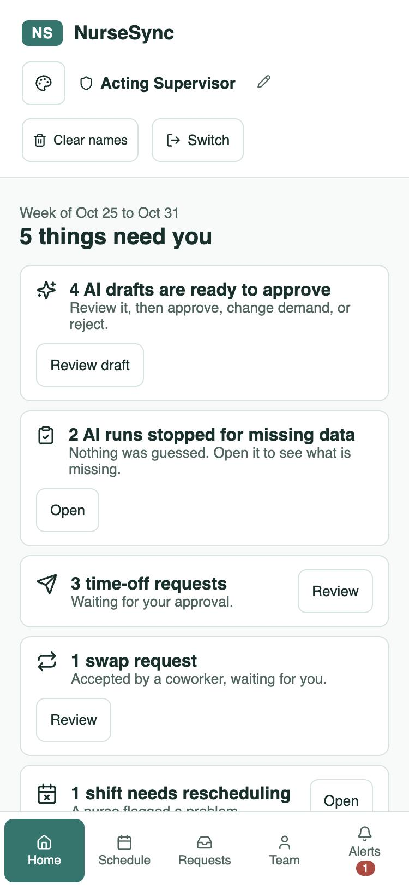
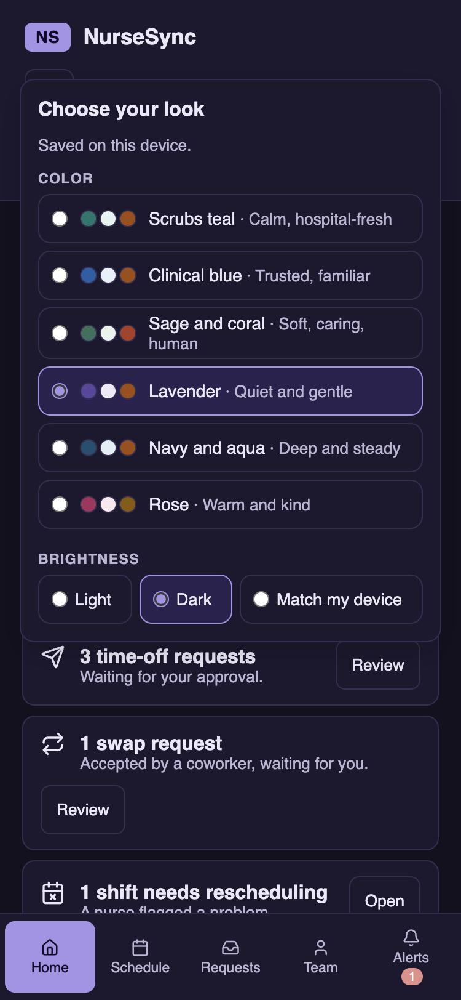
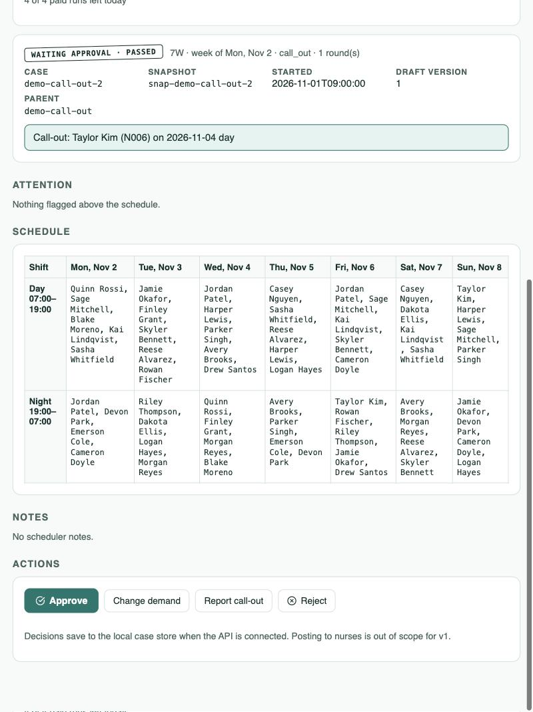
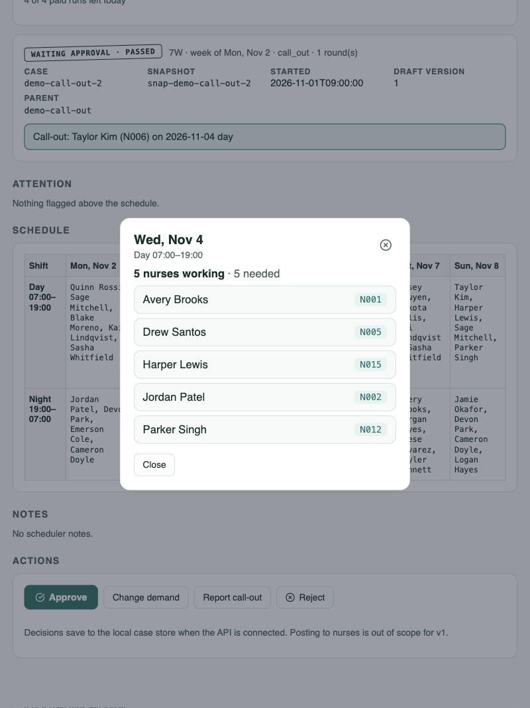
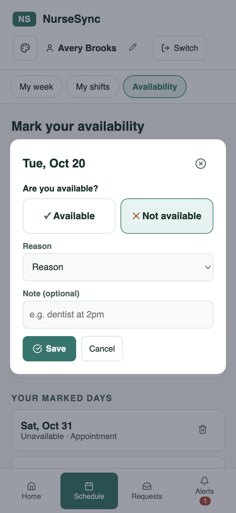
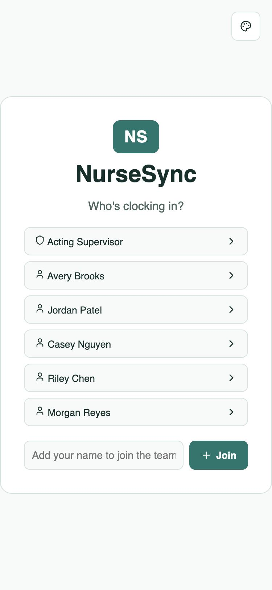
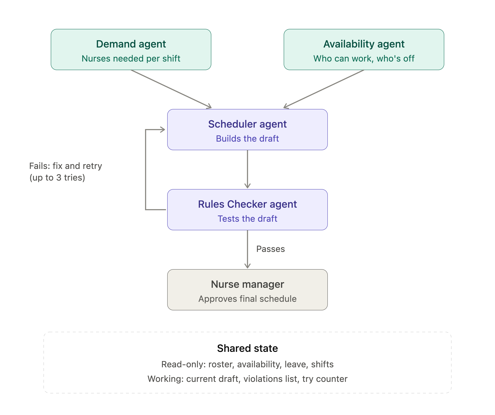

# NurseSync

A team of four AI agents drafts a hospital unit's weekly nurse schedule. Plain code checks every draft against the staffing rules, and the nurse manager reviews and approves. Nothing goes out until a person says yes.

Built by **Cheich Toure** and **Kerrian Gordon**. Mock data only: no real patient or staff information.

<table>
  <tr>
    <td align="center"><br><sub>A nurse's Home</sub></td>
    <td align="center"><br><sub>The manager's "Needs you"</sub></td>
    <td align="center"><br><sub>Six palettes, light and dark</sub></td>
  </tr>
</table>

## The problem

Nurse managers spend hours every week building schedules by hand. Staffing needs change daily, availability and time-off requests live in different places, and rules like rest time and overtime are easy to miss. Violations are often found only after the schedule is posted, and a late call-out sends everyone back to the spreadsheet.

## What it does

- **Drafts the week.** Agents work out demand and availability, then build a schedule that covers every shift.
- **Checks it with code, not a model.** A rules function (`check_rules`) decides whether a draft is safe. The AI can propose, but it can never mark its own work as passing.
- **Handles a late call-out.** The manager reports a sick nurse, the rest of the week is locked, and only the affected shift is re-planned. Code rejects any draft that changes a locked assignment.
- **Keeps a person in charge.** The manager approves, rejects, or changes a demand number. A change starts a new case and retires the old one, so the history stays honest.

## See it

<table>
  <tr>
    <td valign="top"><br><sub><b>The AI draft.</b> A week grid, what changed since the last run, and the manager's four choices.</sub></td>
    <td valign="top"><br><sub><b>One click on a shift</b> shows who is working, with names and IDs, against how many were needed.</sub></td>
  </tr>
  <tr>
    <td valign="top"><br><sub><b>Availability.</b> Tap a day, choose Available or Not available, pick a reason.</sub></td>
    <td valign="top"><br><sub><b>Pick-a-name login.</b> There is no real sign-in yet, and the app says so.</sub></td>
  </tr>
</table>

## How it works



1. **Demand** works out how many nurses each shift needs. **Availability** collects who can work and who has approved time off. They run at the same time.
2. **Code stamps every row** `ok`, `needs_review` or `missing`. Agents never write that status. A missing required row stops the run before the Scheduler, so nothing is guessed.
3. The **Scheduler** drafts the week. `check_rules` judges it, and the **Rules Checker** only adds plain-language fix hints. They loop up to three rounds.
4. The **manager** reviews the draft and the notes that need a human look, then approves.

## Decisions worth reading

- **Code decides if a schedule is safe.** A model reviewing a model's work shares its blind spots, so the pass or fail comes from a pure function with unit tests, not from an agent.
- **One frozen snapshot per run.** Every agent and `check_rules` read the same copy, so a draft can't be checked against data that changed under it.
- **Agent text is untrusted.** Notes and review items from agents are cleaned (length, count, plain text) and shown to the manager, but they never change a status or stop a run.
- **Approved leave beats a model.** If an agent marks a nurse available on a day with approved leave, code overrides it and flags the row.
- **Missing data is a gap, not a guess.** The unscheduled shift is listed as an open gap with a one-sentence reason. A nurse is never invented.
- **Paid runs are capped.** Weekly runs and call-outs spend real money, so a daily limit counts each one when it is accepted and fails closed if its file is unreadable.
- **A local API that doesn't trust the browser.** It binds to `127.0.0.1` and checks the Host header, the Origin header and the content type on every write. An early review found a cross-site and DNS-rebinding gap; it was fixed and re-tested against a running server.
- **Accessible by default.** Keyboard use, labelled controls, a visible focus ring, status that never relies on color alone, and six palettes whose text contrast (at least 4.5 to 1) is checked by the build, so a bad palette can't ship.

## Evidence

- **397 backend tests**, none of which call the API or cost anything.
- **Evals against a single-agent baseline.** The cards cover a normal week, overnight rest, the 3-round limit, certifications and overtime, missing data, and a late call-out. Each live card was run three times and passed. On three of them the baseline did just as well, and the results file says so. See [the results](backend/evals/phase1/RESULTS.md).
- **A real end-to-end run from the UI:** about two minutes, one round, zero hard violations, 62 assignments, at an estimated $0.50 to $1.50.

## Run it

```bash
npm install
npm run dev                  # the app, at http://localhost:5173 (pick "Acting Supervisor" for the manager view)
npm run build                # also checks every palette's contrast
```

The AI side is optional. The app opens without it and shows sample cases.

```bash
python3 -m venv .venv && .venv/bin/pip install -r backend/requirements.txt
cd backend && ../.venv/bin/python -m pytest -q                    # free
../.venv/bin/python -m app.serve --seed-samples                   # the case API at http://127.0.0.1:8000
NURSESYNC_LIVE=1 ../.venv/bin/python -m app.serve                 # live agents (needs ANTHROPIC_API_KEY in .env)
```

Put the key only in the repo-root `.env` (see `.env.example`). Never prefix it with `VITE_`, and never commit it.

## What's in the repo

| Path | What it is |
| --- | --- |
| `src/` | The React app: login, nurse and manager homes, availability, swaps, leave, the AI-draft approval view, themes |
| `backend/app/` | The orchestrator, the contract (forms), `check_rules`, decisions, call-outs, the case store, the API, the live agents |
| `backend/evals/` | The eval cards and recorded results |
| `docs/` | [Status and handoff](docs/STATUS.md), [API](docs/api-v0.md), [approval view](docs/approval-view-v0.md), sample cases |
| [PRD (PDF)](NurseSync%20PRD%20-%20Cheich%20Toure%20and%20Kerrian%20Gordon.pdf) | The problem, users, solution, tools, system prompt, risks and eval cases |

## Limits, stated plainly

- **No login.** It is pick-a-name, and it is **not secure**. Nothing here should be called secure yet.
- **Per-device data.** The app's own roster, shifts and requests live in the browser, so they aren't shared between people.
- **Mock data and one unit.** One 7W week of synthetic nurses. Nothing is sent to nurses.
- **Shift swaps are a one-way handoff.** A two-way trade is not built.

What's next is tracked in [docs/STATUS.md](docs/STATUS.md): a real Shift Board source, a login, and wiring call-outs into the weekly run.
